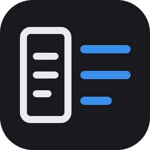

<p align="center"></p>

<h1 align="center">Review Handoff</h1>

<p align="center">Review what Claude Code and Codex change, before it ships.<br>Grouped diffs with the why inline, independent reviewers, tests on Modal, and a checklist you hand back to the agent.</p>

<p align="center">
  <a href="https://vscode.dev/redirect?url=vscode:extension/onepunchmonk.review-handoff"></a>
  &nbsp;
  <a href="https://marketplace.visualstudio.com/items?itemName=onepunchmonk.review-handoff"></a>
</p>

## Install (two clicks)

1. Click **Install in VS Code** above. VS Code opens on the extension's page.
2. Click **Install**.

The **Review Handoff** icon appears in the Activity Bar on the left. On first start the extension installs its agent skill for Claude Code (`~/.claude/skills/review-handoff`) and Codex (`~/.codex/skills/review-handoff`), so there is nothing else to set up.

If your workspace is in Restricted Mode, trust the folder: the extension runs `git` and starts agent sessions, so it stays off in untrusted workspaces.

<details><summary>Install without the Marketplace</summary>

Download `review-handoff-<version>.vsix` from [Releases](https://github.com/OnePunchMonk/review-handoff/releases), then:

```bash
code --install-extension review-handoff-<version>.vsix
```
</details>

## Why

Coding agents change a lot in one sweep, and the terminal shows you a wall of edits. You end up approving changes you never really read. Review Handoff makes the agent explain itself and gives you a review loop you control:

- **Grouped changes.** Every changed block is grouped into the logical change it belongs to, across files, in reading order. Code that no explanation covers is flagged with `?`. With [Graphify](https://github.com/Graphify-Labs/graphify) installed, groups follow the real call graph.
- **One step at a time.** The summary is capped at 70 words, each step shows 1-2 sentences of why, and long explanations are folded under Details, where you can ask follow-up questions.
- **Not just the agent's word.** One click runs independent checks headless: a senior-review scorecard, Codex (via its MCP server), a fresh-context Goldfish review in the [Elephant-Goldfish](https://github.com/google/elephant-goldfish-model) style, [Ponytail](https://github.com/DietrichGebert/ponytail), and your targeted tests on Modal CPU.
- **You decide.** Tick what to fix, explain, test or revert, add instructions, clarifications and things to remember, then **Send**. Or **Approve & push**: it commits only the reviewed files and pushes the branch, after a confirm, never from main.
- **Data stays out of the way.** Binary files and large generated dumps are set aside, and files the agent changed without mentioning are flagged.

## How it works

1. When a change is ready, ask your agent for **/review-handoff**. It writes `.review/review.json`: a short summary, one note per logical change, test targets. VS Code opens the review.
2. One screen beside the diff: the summary, a **map** of the change (one box per step), one line of checks, and the **current step**. Each step shows its why, its code on the left, and only the concerns found in that code. Mark it *Looks good*, *Needs change* or *Question* and move on (`j`/`k`, `g`/`c`/`q`).
3. **Run checks** runs everything in the background: a fresh-context review of reuse, dead code, missing tests, tests worth adding, architecture, simplicity, scale and maintenance; Codex; Goldfish; Ponytail; your tests on Modal. Nothing to watch, findings land on the step they belong to.
4. **Send** writes `.review/feedback.json` and copies one line to paste into your agent, or **Approve & push**. Every round is kept under History with "Compare with now", so you see what the agent did with your feedback.

```
terminal ── /review-handoff ──▶ .review/review.json ──▶ one screen in VS Code
   ▲                                                         │
   └── paste one line ◀── .review/feedback.json ◀── Send ─────┘
```

`.review/` is added to `.git/info/exclude` and never committed.

## Tasks: parallel work without the mess

Open **Tasks** from the sidebar. Dump everything you need done. An agent splits it into separate, reviewable tasks, flags anything unclear as a question, and recommends an agent and model for each one (for example Codex `gpt-5.6-luna` at low effort for a small fix, Claude Opus at high effort for a design call). Approve, and each task starts on its own branch, in its own worktree and terminal. Tasks show up as tabs in the review panel when they are ready.

**Any agent.** Profiles pair a CLI with a model and effort: Claude Code, Codex, or any other CLI through a command template (`reviewHandoff.agentProfiles`). Pick the organiser on the board; set `reviewHandoff.jobProfile` for checks.

```json
{ "id": "gemini", "label": "Gemini CLI", "cli": "command", "model": "gemini-2.5-pro",
  "command": ["gemini", "-m", "{model}", "-p", "{prompt}"] }
```

## Skills, without remembering them

Press **⌥⌘K** (Ctrl+Alt+K) to search every skill you have: personal, project and plugin, most used first. Run one in a fresh session or copy its `/command`. The same list includes the Claude Code plugin store, so you can install new skills from it.

## Requirements

- VS Code 1.90 or newer, `git`
- [Claude Code](https://claude.com/claude-code) and/or Codex CLI
- Optional: [`gh`](https://cli.github.com) for PR review threads, [`modal`](https://modal.com) for tests, Graphify, and the EGM or Ponytail plugins (the Checks tab offers to install them)

## Settings

| Setting | Default | |
|---|---|---|
| `reviewHandoff.autoOpen` | `true` | Open the review when `.review/review.json` is written |
| `reviewHandoff.agentProfiles` | built-in five | CLI, model and effort pairs for tasks |
| `reviewHandoff.organiserProfile` | `claude-sonnet-medium` | Splits a task dump |
| `reviewHandoff.jobProfile` | `claude-sonnet-medium` | Runs reviewers and the diagram |
| `reviewHandoff.claudePath`, `modalPath` | found on PATH | |

## Privacy

Everything runs locally through your own `git`, `gh`, `claude`, `codex` and `modal` CLIs. The extension never posts to GitHub: replies you type on PR threads are saved for the agent as drafts.

## Develop

No build step and no dependencies.

```bash
npx @vscode/vsce package     # builds review-handoff-<version>.vsix
code --install-extension review-handoff-*.vsix
```

Releases: push a tag `v*`. CI builds the `.vsix`, attaches it to a GitHub release, and publishes to the Marketplace and Open VSX when the `VSCE_PAT` and `OVSX_PAT` secrets are set.

MIT licensed.
